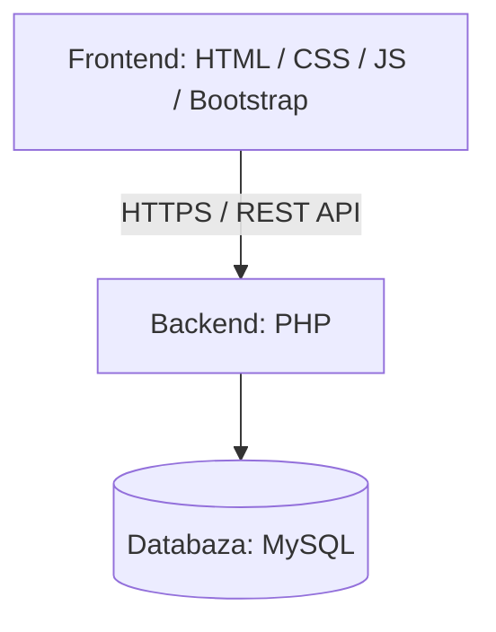
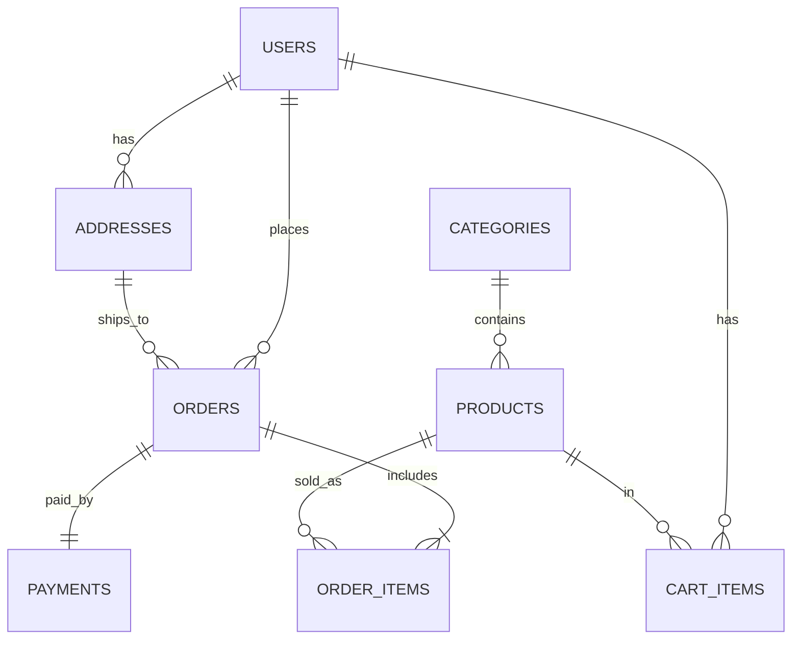

# GentaOlloni-SistemiPorosiveOnline

Tema: Sistemi për Menaxhimin e Porosive Online (E-Commerce)

## Raporti 1

### Ideja

Ideja është të ndërtohet një aplikacion web për menaxhimin e porosive online, ku klientët mund të shfletojnë produktet, t'i shtojnë në shportë dhe të bëjnë porosi, ndërsa administratorët mund të menaxhojnë produktet, stokun dhe statusin e porosive në mënyrë të qartë dhe të sigurt.

Problemi që zgjidhet: shumë biznese të vogla i pranojnë porositë manualisht (telefon, rrjete sociale, Excel), gjë që sjell gabime, porosi të humbura dhe stok të pasaktë. Ky sistem i centralizon të gjitha në një vend.

### Përdoruesit (rolet)

- **Klienti**: regjistrohet, shfleton produktet, bën porosi dhe e ndjek statusin.
- **Administratori**: menaxhon produktet, kategoritë dhe porositë.

### Kërkesat funksionale

- KF01: Përdoruesi mund të regjistrohet dhe të hyjë (login) me email dhe fjalëkalim.
- KF02: Klienti mund t'i shfletojë produktet, të kërkojë dhe t'i filtrojë sipas kategorisë dhe çmimit.
- KF03: Klienti mund t'i shohë detajet e një produkti (përshkrimi, çmimi, stoku).
- KF04: Klienti mund të shtojë, heqë dhe ndryshojë sasinë e produkteve në shportë.
- KF05: Klienti mund ta konfirmojë porosinë duke zgjedhur adresën e dërgesës dhe mënyrën e pagesës (pagesë në dorëzim).
- KF06: Klienti mund ta shohë historikun e porosive dhe statusin e secilës.
- KF07: Klienti mund ta anulojë porosinë vetëm derisa ajo është në statusin "PENDING".
- KF08: Administratori mund të krijojë, ndryshojë dhe fshijë produkte dhe kategori.
- KF09: Administratori mund t'i shohë të gjitha porositë dhe ta ndryshojë statusin (PENDING → CONFIRMED → SHIPPED → DELIVERED ose CANCELLED).
- KF10: Stoku zvogëlohet automatikisht pas porosisë; porosia refuzohet nëse nuk ka stok të mjaftueshëm.
- KF11: Administratori ka një dashboard me statistika bazë (numri i porosive, shitjet totale, produktet me stok të ulët).

### Kërkesat jofunksionale

- Fjalëkalimet ruhen vetëm në formë të hash-uar.
- Endpoint-et private kërkojnë autentikim, ndërsa autorizimi sipas rolit bëhet në backend.
- Input-i validohet para se të ruhet në databazë.
- Çdo përdorues, produkt dhe porosi ka ID unike.
- Aplikacioni është responsiv dhe i përdorshëm edhe në ekran mobil.
- Secrets dhe çelësat (p.sh. `.env`) nuk ngarkohen në repository.
- Gabimet kthehen në format të kontrolluar me status code të duhur.

### Teknologjitë dhe arkitektura

| Shtresa | Teknologjia | Arsyeja |
|---|---|---|
| Frontend | HTML, CSS, JavaScript, Bootstrap | Të njohura, responsive me shpejtësi |
| Backend | PHP (REST API), sesione (session) | Gjuhë që e njoh dhe e ruan lehtë lidhjen me MySQL |
| Databaza | MySQL | Relacionale, ideale për porosi dhe relacione |
| Mjete | Git/GitHub, XAMPP, phpMyAdmin, Postman, VS Code | Server lokal, menaxhim i databazës dhe testim i API-ve |

Arkitektura është monolitike me tre shtresa (frontend, backend, databazë), me module të ndara sipas funksionalitetit:

**Modulet:** Autentikimi dhe përdoruesit, Produktet dhe kategoritë, Shporta, Porositë, Pagesat, Administrimi.

### Modeli fillestar i databazës

| Tabela | Për çfarë shërben |
|---|---|
| users | Llogaritë: emri, email-i (unik), password hash dhe roli |
| addresses | Adresat e dërgesës të klientit |
| categories | Kategoritë e produkteve |
| products | Produktet: çmimi, stoku, kategoria |
| cart_items | Produktet në shportën e secilit klient |
| orders | Porositë: klienti, adresa, statusi, totali |
| order_items | Produktet brenda një porosie (sasia dhe çmimi në momentin e blerjes) |
| payments | Pagesa e porosisë: mënyra dhe statusi |

Relacionet kryesore:

- `users` 1 → N `addresses`, `orders`, `cart_items`
- `categories` 1 → N `products`
- `orders` 1 → N `order_items`
- `products` 1 → N `order_items` (kështu `orders` dhe `products` lidhen many-to-many përmes `order_items`)
- `orders` 1 → 1 `payments`

### Endpoint-et kryesore të planifikuara

| Method | Endpoint | Qëllimi |
|---|---|---|
| POST | /api/auth/register | Regjistrimi i përdoruesit |
| POST | /api/auth/login | Autentikimi |
| GET | /api/products | Lista e produkteve (me filtra) |
| POST | /api/products | Krijon produkt (vetëm admin) |
| POST | /api/cart | Shton produkt në shportë |
| POST | /api/orders | Krijon porosi nga shporta |
| GET | /api/orders | Porositë e përdoruesit |
| PATCH | /api/orders/:id/status | Ndryshon statusin (vetëm admin) |

### Plan pune

Kërkesat → Dizajnimi → Implementimi → Testimi → Deployment

| Raporti | Fokusi | Rezultati i pritshëm |
|---|---|---|
| Raporti 1 | Analiza, kërkesat, dizajni teknik | Repository, arkitektura, modeli i databazës, plan pune |
| Raporti 2 | Databaza, backend dhe API | Databaza reale, autentikimi, endpoint-et kryesore, testim me Postman |
| Raporti 3 | Frontend dhe integrimi | Katalogu, shporta dhe porosia nga UI deri në databazë |
| Raporti 4 | Testim, siguri, deployment | Test cases, kontrolle sigurie, version beta i deploy-uar |
| Final | Mbrojtja teknike | Live demo, kodi, Git history, dokumentimi |

### Jashtë scope-it të këtij semestri

Pagesa online me kartelë, integrimi me kurier real, kuponat dhe zbritjet, vlerësimet e produkteve.
